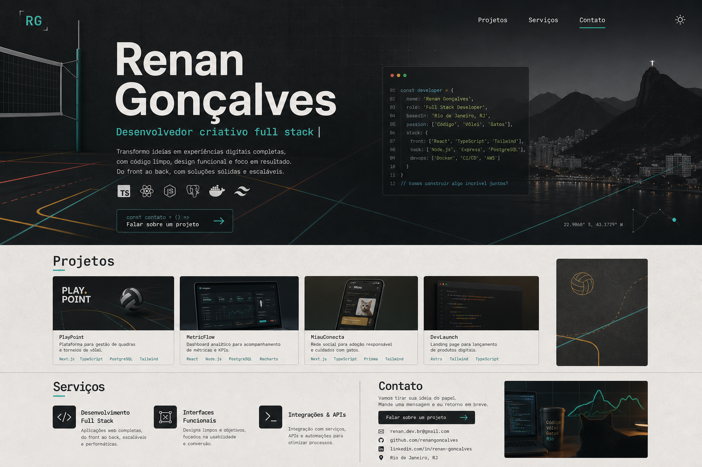

# Manual de Marca - Renan Goncalves

## 1. Essencia da Marca

**Posicionamento central:** Renan Goncalves e um desenvolvedor criativo full stack que une codigo, design, jogos digitais e visao pratica de produto para transformar ideias em experiencias digitais claras, funcionais e memoraveis.

**Promessa:** entregar solucoes digitais com raciocinio tecnico, sensibilidade visual e comunicacao direta.

**Personalidade:**
- Criativo tecnico
- Direto e acessivel
- Curioso e pratico
- Jovem, mas profissional
- Urbano, atento e em movimento

**Publicos principais:**
- **Recrutadores:** precisam entender experiencia, formacao, stack, capacidade de aprender, trabalhar em equipe e entregar.
- **Clientes freelance:** precisam entender valor, tipos de projeto, confianca, processo e caminho facil para contato.

## 2. Pilares de Comunicacao

### Tecnico com clareza
Falar de codigo, sistemas, APIs, performance e organizacao sem soar distante ou excessivamente corporativo.

**Exemplo bom:** "Construo interfaces, sistemas e integracoes com foco em clareza, manutencao e experiencia de uso."

**Evitar:** "Solucoes tecnologicas inovadoras para alavancar negocios digitais."

### Criativo com repertorio
Trazer jogos digitais, design, interacao e interface como diferenciais reais, nao como decoracao.

**Exemplo bom:** "Minha base em jogos digitais me ajuda a pensar fluxo, resposta visual e interacao como parte da experiencia."

**Evitar:** "Sou apaixonado por criar experiencias perfeitas."

### Proximo e resolutivo
Comunicar disponibilidade, processo e capacidade de resolver problemas reais.

**Exemplo bom:** "Se voce precisa tirar uma landing page, sistema ou ideia digital do papel, eu posso estruturar, construir e ajustar com voce."

**Evitar:** "Entre em contato para transformar seus sonhos em realidade."

## 3. Tom de Voz

**Como deve soar:**
- Claro
- Confiante
- Humano
- Objetivo
- Com energia, sem exagero

**Como nao deve soar:**
- Generico
- Corporativo demais
- Infantil
- Cheio de buzzwords
- Superpromissor sem prova

**Frases guia:**
- "Codigo com contexto."
- "Interface, sistema e entrega no mesmo raciocinio."
- "Projetos digitais com estrutura, visual e uso real."
- "Do prototipo ao deploy, com clareza no caminho."

## 4. Direcao Visual

**Conceito visual:** urbano carioca tech.

A identidade deve misturar cidade, tecnologia e movimento. O visual nao deve parecer uma pagina SaaS azul generica, nem uma identidade gamer literal. As referencias pessoais entram como detalhes de ritmo, geometria e microinteracao.

**Referencias sutis:**
- **Volei:** linhas de quadra, diagonais, marcacoes, movimento lateral, blocos de acao.
- **Gatos:** curvas pequenas, agilidade, olhar atento, detalhes discretos; nunca mascote infantil.
- **Tech:** grids, cursor, terminal, interfaces, microinteracoes, estrutura modular.
- **Rio urbano:** energia, contraste, concreto, calor visual; evitar praia, Cristo, pao de acucar ou cliches turisticos.

## 5. Paleta

### Tokens principais

| Uso | Nome | Hex | Observacao |
| --- | --- | --- | --- |
| Fundo claro | Concreto frio | `#F4F7F6` | Base limpa, levemente urbana |
| Fundo escuro | Grafite profundo | `#101417` | Escuro principal, nao preto puro |
| Superficie clara | Neblina | `#FFFFFF` | Cards e areas de leitura |
| Superficie escura | Asfalto | `#182024` | Cards no tema escuro |
| Texto principal claro | Tinta urbana | `#11181C` | Alto contraste |
| Texto principal escuro | Branco nevoa | `#F3F8F7` | Alto contraste em dark |
| Primaria | Ciano urbano | `#00C2B8` | Tecnologia, clareza e destaque |
| Secundaria | Coral energia | `#FF6B4A` | Acao, calor e personalidade |
| Apoio | Amarelo quadra | `#F7C948` | Detalhes, linhas e acentos |
| Neutro | Concreto medio | `#8A9699` | Texto secundario e bordas |

### Regras de uso
- Ciano urbano deve ser a cor de acao e assinatura principal.
- Coral deve aparecer em pontos de energia, nao dominar a pagina.
- Amarelo deve ser usado como detalhe grafico, inspirado em marcacoes de quadra.
- Azul SaaS nao deve ser cor dominante.
- Em dark mode, manter contraste alto e evitar superficies pretas chapadas.

## 6. Tipografia

**Fonte de interface:** Inter ou similar.

Uso: textos, navegacao, botoes, paragrafos e informacoes tecnicas.

**Fonte de destaque sugerida:** Space Grotesk, Sora ou Plus Jakarta Sans.

Uso: nome, titulos, secoes principais e chamadas. Deve trazer personalidade tecnica sem perder leitura.

**Hierarquia recomendada:**
- H1: forte, compacto, com presenca editorial.
- H2: claro e modular.
- Texto: direto, com linhas curtas.
- Labels e badges: pequenos, objetivos, sem excesso de capsulas arredondadas.

## 7. Logo e Assinatura

**Assinatura principal:** Renan Goncalves.

**Monograma opcional:** RG ou R/GCV.

**Direcao visual do monograma:**
- Geometrico
- Legivel em tamanho pequeno
- Compatibilidade com favicon e avatar
- Pode usar barra, cursor, grid ou corte diagonal
- Nao deve usar bola, gato ou simbolo de codigo de forma literal

**Usos:**
- Header do portfolio
- Favicon
- Imagem Open Graph
- Avatar tecnico/social
- Assinatura em documentos e propostas

## 8. Iconografia e Elementos Graficos

**Icones:**
- Linha simples, stroke consistente, preferencialmente lucide ou sistema equivalente.
- Evitar icones preenchidos demais.
- Usar icones apenas quando ajudarem a leitura.

**Elementos graficos:**
- Linhas diagonais finas inspiradas em quadra.
- Pequenos pontos ou cursores como detalhes tech.
- Grids discretos em backgrounds.
- Bordas de 1px com baixo contraste.
- Raio de borda entre 6px e 10px.

**Evitar:**
- Glassmorphism pesado.
- Cards muito arredondados.
- Gradientes roxos/azuis genericos.
- Ilustracoes abstratas sem relacao com a marca.
- Mascote de gato ou bola de volei literal.

## 9. Componentes do Portfolio

### Hero
Objetivo: em 5 segundos, a pessoa deve entender quem e Renan, o que ele faz e por que continuar.

**Conteudo recomendado:**
- Nome forte: "Renan Goncalves"
- Posicionamento: "Desenvolvedor criativo full stack"
- Texto curto: codigo, design, jogos digitais e produto
- CTAs: "Ver projetos" e "Falar sobre um projeto"

**Visual:**
- Fundo com grid discreto
- Linhas diagonais ou de quadra
- Um bloco visual tecnico, como terminal/projeto/codigo
- Sem badge decorativo acima do titulo

### Projetos
Objetivo: servir aos dois publicos.

**Para recrutadores:** stack, papel no projeto, aprendizado e complexidade.

**Para clientes:** tipo de entrega, resultado esperado e aplicacao pratica.

**Formato recomendado:**
- Cards ou linhas de projeto com imagem forte.
- Tag de categoria: jogo, landing page, sistema, e-commerce.
- Tecnologias como apoio, nao como elemento principal.
- CTA claro: demo, codigo, trailer ou download.

### Servicos
Objetivo: vender capacidade de entrega sem parecer lista generica.

**Categorias:**
- Sites e landing pages
- Sistemas web
- E-commerce
- Apps e prototipos
- Integracoes e APIs

**Cada servico deve responder:**
- Para quem e
- Que problema resolve
- O que Renan entrega
- Como iniciar conversa

### Contato
Objetivo: reduzir friccao.

**Prioridade:** WhatsApp como contato comercial principal.

**Tambem mostrar:** GitHub, LinkedIn e Instagram com contexto de uso.

## 10. Imagens e Mockups

**Estilo de imagem:**
- Projetos reais sempre que possivel.
- Imagens de jogos devem aparecer com destaque, pois sustentam o repertorio criativo.
- Imagens de landing pages devem parecer comerciais e objetivas.
- Evitar stock generico sem relacao clara com o projeto.

**Mockup visual inicial:**

Este mockup e uma referencia de direcao, nao uma tela final aprovada. Antes de implementar no site, validar:
- Paleta
- Densidade
- Nivel de referencias pessoais
- Hierarquia do hero
- Tratamento dos projetos e servicos

## 11. Nao Usar

- Azul corporativo/SaaS como cor dominante.
- Glassmorphism como linguagem principal.
- Cards excessivamente arredondados.
- Textos genericos como "transformar ideias em realidade" sem contexto.
- Referencias literais ou infantis a gatos e volei.
- Cliches visuais do Rio.
- Excesso de badges e pills no hero.
- Layout que pareca template sem assinatura pessoal.

## 12. Criterios de Aprovacao Antes de Implementar

Antes de alterar a pagina, aprovar:
- A paleta principal e secundaria.
- O nivel de presenca das referencias pessoais.
- A frase principal do hero.
- O estilo do monograma ou decisao de usar apenas wordmark.
- A estrutura dos projetos para recrutadores e clientes.
- A lista final de servicos.

## 13. Checklist de Implementacao Futura

- Atualizar tokens CSS e dark mode.
- Revisar copy do hero, projetos, servicos e contato.
- Ajustar componentes para raio menor e visual mais urbano.
- Introduzir linhas, grid e microinteracoes de movimento diagonal.
- Criar ou revisar favicon/OG com assinatura ou monograma.
- Validar responsividade em mobile, tablet e desktop.
- Rodar lint e build.
- Fazer revisao visual antes de publicar.
